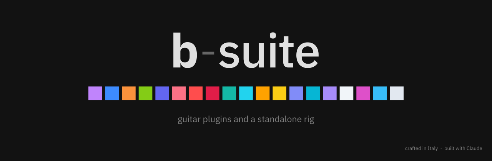

<p align="center"></p>

Plugins (VST3 / AU) and a standalone app for recording electric guitar at home. From the raw DI to a mix that still holds up on a phone speaker.

Crafted in Italy with love 🇮🇹 · **Status:** beta.

## How it was made

I didn't write the C++ myself: the whole suite was written with Claude Code. The ideas, the sound and the choices are mine.

Every plugin started as a small annoyance while recording: a DI that hisses, palm mutes that turn to mush, a cab that doesn't feel like a real one in headphones, a guitar flattened by Instagram's compression. So each one does one job, and shows you what it's doing.

No fake knobs or screws. Dark, flat, one colour per plugin and a live display. Click any logo to find out what that plugin is for.

## The plugins

### Before the amp

- **b-drop**: tunes the guitar down or up while you play, from -12 to +12 semitones. The pick attack goes through right away; the shifted note follows a few milliseconds later, so it still feels like playing.
- **b-focus**: removes hiss and hum from the DI between notes and leaves the notes alone. `learn` listens to your noise for a few seconds and sets itself.
- **b-fs** (b-freshstrings): the sound of new strings, a different pick and another pickup position.
- **b-tight**: tightens the low end before the amp. Pick your tuning and it sets the low cut, keeps palm mutes tight and sharpens the attack. With no tuning chosen it stays out of the way.

### Amp, cab and effects

- **b-amp**: an amp head with three channels: clean, crunch and a lead that goes all the way to djent. Noise gate and tuner built in. Click the pilot light to look at the back.
- **b-distort**: five distortions (tube, drive, rat, fuzz, fold) matched in loudness, so you compare the sound, not the volume.
- **b-wire**: follows your notes and plays them back as a raw synth one or two octaves down.
- **b-starve**: a circuit running out of power, then three glitch effects: freezes, bit errors and a melting filter.
- **b-blend**: up to four cab IRs, lined up and mixed on a pad. The built-in browser shows every IR in a folder as a curve, and you hear each one as you click it.

### After the cab

- **b-double**: turns one take into two guitars, wide in stereo and still fine in mono.
- **b-aftercab**: everything after the cab in one place: EQ, compressor, delay and reverb, and an output that keeps the level where it was.
- **b-dynaverb**: notices when you play a lead line on the high strings and only then adds a mid boost and a delay. Riffs stay dry.
- **b-space**: puts the amp in a real room. You pick the room, the walls and where the amp and you are standing, instead of turning reverb knobs.
- **b-delay**: five kinds of repeats (digital, tape, bucket brigade, lo-fi, reverse), tempo sync and tap.
- **b-verb**: room, plate, hall, spring and shimmer, with freeze.
- **b-scenery**: vinyl crackle, amp hum and rain, generated live, that duck under your playing so they never get in the way.

### On the master

- **b-adapt**: makes the mix survive phone speakers and social media compression. A phone monitor lets you hear how it will sound there (switch it off before you export).
- **b-meter**: the last slot. Spectrum, stereo and loudness, and one click to hit the level Instagram, YouTube or a streaming release expects.
- **b-synthesia**: visuals that move with the guitar, for playthrough videos. The audio isn't touched.

Every plugin folder has its own `README.md` with every control and the numbers measured in the tests.

## b-rig

The whole suite as one app: plug in the guitar and play, no DAW. Tuner, metronome, presets and undo. b-amp stays quiet until there's a cab after it, and a limiter protects the output.

Installers for macOS (Apple Silicon) and Windows (x64 and ARM). More in `b-rig/README.md`.

## Suggested order

On the guitar track:

```text
DI → b-drop → b-focus → b-fs → b-tight → (b-wire / b-starve / b-distort)
   → b-amp → b-blend → b-double → b-aftercab → b-dynaverb
   → b-delay / b-verb → b-space → b-scenery
```

On the master: `b-adapt → b-meter`, with b-synthesia wherever you like.

Everything in brackets, and everything after b-aftercab, is optional.

## Build

JUCE 9 and C++20, built with CMake. JUCE is a submodule, so clone with `--recursive` (or run `git submodule update --init`).

```bash
cd b-aftercab        # or any plugin folder, or b-rig
cmake -S . -B build -G Ninja -DCMAKE_BUILD_TYPE=Release
cmake --build build
```

On macOS the plugins are copied to `~/Library/Audio/Plug-Ins` after the build and show up in Logic Pro under "b-suite". Each folder also builds a test program that measures the sound and saves screenshots of the interface.

## Releases and updates

- New b-rig version: `tools/release.sh b-rig 0.2.0`. It sets the version, tags it and pushes; GitHub builds the installers and publishes the release.
- b-rig and the plugins check for a new version once a day. If there is one, a small notice shows up in the corner; click it and the about panel opens with a download button.

## Logo

`docs/` has the logo in three sizes: the banner above, a full-screen version (1920 × 1080) and a square icon (1024 × 1024). One square per plugin, in the order of the chain.
