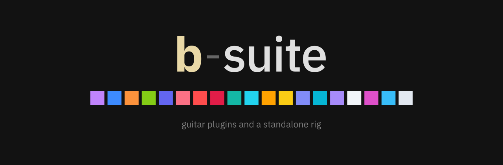

<p align="center"></p>

Audio plugins (VST3 / AU) and a standalone app for recording electric guitar at home: from cleaning up the raw DI to the amp, the cab, the effects and a mix that holds up on a phone speaker.

Crafted in Italy with love 🇮🇹

**Status:** beta.

## How it was made

I didn't write the C++ by hand: the whole suite was written with Claude Code. The ideas, the sound and the choices are mine. Every plugin comes from something I needed while recording: a quiet DI, tight palm mutes, a cab that feels like a real one in headphones, a guitar that survives Instagram's compression.

The interface is the same across the suite: dark, flat, no fake knobs or screws. Each plugin has its own colour and a live display that shows what is happening to the sound. Click a plugin's logo to read what it does.

## The plugins

### Before the amp

- **b-drop**: tunes the guitar down or up (±12 semitones) while you play. The pick attack passes with no delay; the shifted note follows a few milliseconds later.
- **b-focus**: removes hiss and hum from the DI between and under the notes, with no latency. `learn` listens to your noise for a few seconds and sets itself.
- **b-fs** (b-freshstrings): new strings, a different pick and another pickup position on the clean DI.
- **b-tight**: tightens the DI before the amp. Pick a tuning and it sets the low cut, holds palm mutes in place and shapes the pick attack. With no tuning chosen it does nothing.

### Amp, cab and effects

- **b-amp**: an amp head with three channels (clean, crunch, lead), a noise gate and a tuner. Click the pilot light to see the back of the head.
- **b-distort**: five distortions (tube, drive, rat, fuzz, fold), all at the same loudness, so switching changes the character and not the volume.
- **b-wire**: tracks your notes and plays them back as a raw synth an octave or two below, plus fuzz.
- **b-starve**: a dying circuit and three glitch effects (freezes, bit errors, a melting filter).
- **b-blend**: loads up to four cab IRs, lines them up and mixes them on a pad. A built-in browser shows the response of every IR in a folder, and you hear each one as you pick it.

### After the cab

- **b-double**: turns a mono take into a stereo double that still sounds right in mono.
- **b-aftercab**: the strip after the cab: EQ, compressor, delay and reverb, and an output that keeps the level steady.
- **b-dynaverb**: hears when you play a lead line on the high strings and only then adds a mid boost and a delay.
- **b-space**: puts the amp in a room. You choose the room, the walls and where the amp and the listener stand.
- **b-delay**: a delay with five characters (digital, tape, bucket brigade, lo-fi, reverse), tempo sync and tap.
- **b-verb**: room, plate, hall, spring and shimmer reverb, with freeze.
- **b-scenery**: vinyl crackle, amp hum, rain and lo-fi that react to your playing.

### On the master

- **b-adapt**: gets a mix ready for phones and small speakers. A monitor lets you hear it as a phone would (switch it off before you export).
- **b-meter**: the last slot: spectrum, stereo, loudness and one-click targets for Instagram, YouTube and digital releases.
- **b-synthesia**: visuals that react to the guitar, for playthrough videos. The audio passes untouched.

Each plugin folder has a `README.md` with every control and the measured results.

## b-rig

A standalone app with the plugins inside: plug in the guitar and play, no DAW needed. It has a tuner, a metronome, presets, undo/redo and a limiter on the output. b-amp stays muted until there is a cab after it, so it never blasts raw amp noise into your ears.

Installers: macOS (Apple Silicon) and Windows (x64 and ARM). Details in `b-rig/README.md`.

## Suggested order

Guitar track:

```text
DI → b-drop → b-focus → b-fs → b-tight → (b-wire / b-starve / b-distort)
   → b-amp → b-blend → b-double → b-aftercab → b-dynaverb
   → b-delay / b-verb → b-space → b-scenery
```

Master bus: `b-adapt → b-meter` (b-synthesia anywhere).

Everything in brackets or after b-aftercab is optional.

## Build

JUCE 9 and C++20, built with CMake. JUCE is a submodule, so clone with `--recursive` (or run `git submodule update --init`).

```bash
cd b-aftercab        # or any plugin folder, or b-rig
cmake -S . -B build -G Ninja -DCMAKE_BUILD_TYPE=Release
cmake --build build
```

On macOS the plugins are copied to `~/Library/Audio/Plug-Ins` after the build and show up in Logic Pro under "b-suite". Each folder also builds a test program that measures the sound and saves screenshots of the interface.

## Releases and updates

- A new b-rig version: `tools/release.sh b-rig 0.2.0`. It sets the version, tags it and pushes; GitHub then builds the installers and publishes the release.
- b-rig and the plugins check for a new version once a day. If there is one, a small notice appears in the corner; clicking it opens the about panel with a download button.
