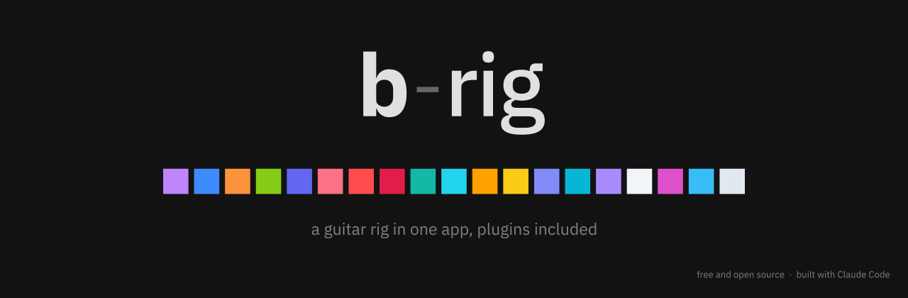
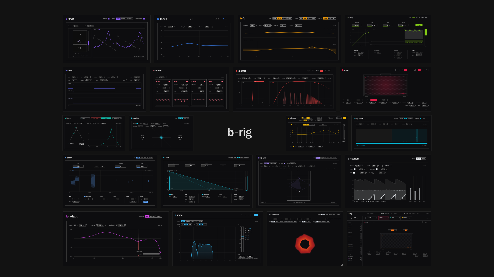
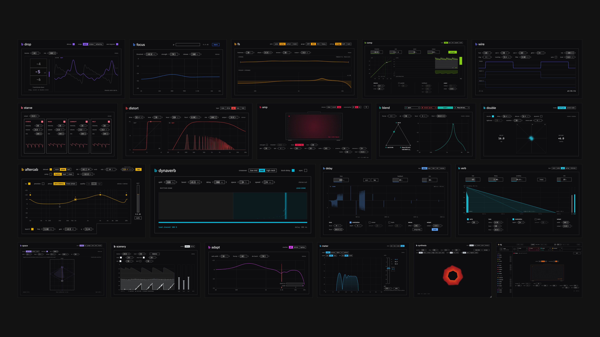

<p align="center"></p>

**b-rig** is a free and open-source guitar rig in one app. Plug in the guitar and play through tuner, amp, cab and effects, with presets and a metronome. No DAW needed.

Its installer can also add **the same effects as plugins** for your DAW: you choose which ones, and whether you want them as Audio Unit, VST3 or both.

**License:** [GNU AGPLv3](LICENSE) · **Status:** beta · **Download:** [latest release](https://github.com/bennhouse/b-rig/releases/latest)

<p align="center"></p>

## Install

1. Download `b-rig-<version>-macos-arm64.dmg` from the [latest release](https://github.com/bennhouse/b-rig/releases/latest) (macOS 11 or later, Apple Silicon).
2. Open it and double-click **Install b-rig**. The installer is not notarized yet, so the first time macOS blocks it: open **System Settings → Privacy & Security** and click **Open Anyway**, then open it again.
3. On the **Installation Type** page b-rig is always selected. Do you also want the plugins? Tick **Add the plugins for your DAW** for all of them, as Audio Unit and VST3. Open it to choose the **Format** (**Audio Unit** for Logic Pro and GarageBand, **VST3** for Ableton Live, Reaper, Cubase…, or both) and, under **Plugins**, only the ones you want: they stay grey until a format is ticked. Leave it unticked for the app only.
4. b-rig includes no cab IRs. To hear b-amp, add b-blend after it and load your own IR files (`.wav`); until then b-amp stays muted. The app says this the first time it opens.

The app goes to Applications, the plugins to `/Library/Audio/Plug-Ins`, where your DAW lists them under "b-suite". Run the installer again to add or remove plugins. A Windows version is in the works.

## The app

- **The chain:** drag modules from the library into the chain and reorder them. Each module is one of the plugins below, with the same sound and interface, at most once in the chain. It starts empty.
- **Split:** divide the chain into two parallel lanes with different modules (two amps, a delay on one side and a reverb on the other), from any point, without making the chain bar any wider. The lanes play left and right (`stereo`, with a measured delay on one side that keeps the mono sum full) or summed (`mono`), and `balance` lines up their phase and evens out their volume.
- **Safe by design:** b-amp stays muted until there is a cab after it, so a raw amp never blasts into your headphones, and a limiter protects the output.
- **Tuner, metronome** (volume and pitch), **presets** with colours, rename, import and export, `save` and `new` in the top bar, **undo / redo** for every change, and audio settings kept between sessions. The app reopens where you left it, unsaved changes included. Presets live outside the app, so updates never touch them.
- **Updates:** once a day b-rig and the plugins check for a new release; a small notice in the corner opens the download. The about panel (click the name) also has `check for updates`.

More in [b-rig/README.md](b-rig/README.md).

## The plugins

The effects of the chain. 16 of them are modules of the app; b-double, b-scenery and b-synthesia are for the DAW only. In a DAW you install the ones you pick in the installer.

### Before the amp

- **b-drop**: tunes the guitar down or up while you play, from -12 to +12 semitones, chords included: it never guesses the note, so the tuning stays stable. The pick attack goes through right away; the shifted note follows about 22 ms later.
- **b-focus**: removes hiss and hum from the DI between notes and leaves the notes alone. `learn` listens to your noise for a few seconds and sets itself.
- **b-fs** (b-freshstrings): the sound of new strings, a different pick and another pickup position.
- **b-comp**: a compressor tuned for guitar, with clean, opto, fet and squash styles and a three-band mode set up for guitar. The graph shows the curve and the gain reduction as you play.

### Amp, cab and effects

- **b-amp**: an amp head with three channels: clean, crunch and a lead that goes all the way to djent. Each head keeps all its own settings. Noise gate that leaves long low notes alone, boost with tone, and tuner built in. Click the pilot light to look at the back.
- **b-distort**: five distortions (tube, drive, rat, fuzz, fold) matched in loudness, so you compare the sound, not the volume.
- **b-wire**: follows your notes and plays them back as a raw synth one or two octaves down.
- **b-starve**: a circuit running out of power, then three glitch effects: freezes, bit errors and a melting filter.
- **b-blend**: up to four cab IRs, lined up and mixed on a pad. The built-in browser shows every IR in a folder as a curve, and you hear each one as you click it.

### After the cab

- **b-double** (DAW only): turns one take into two guitars, wide in stereo and still fine in mono.
- **b-aftercab**: everything after the cab in one place: EQ, compressor, delay and reverb, and an output that keeps the level where it was.
- **b-dynaverb**: notices when you play a lead line on the high strings and only then adds a mid boost and a delay. Riffs stay dry.
- **b-space**: puts the amp in a real room. You pick the room (its size and materials come with it) and where the amp and you are standing, instead of turning reverb knobs, and mix how much of the room you hear.
- **b-delay**: five kinds of repeats (digital, tape, bucket brigade, lo-fi, reverse), tempo sync and tap.
- **b-verb**: room, plate, hall, spring and shimmer, with freeze.
- **b-scenery** (DAW only): vinyl crackle, amp hum and rain, generated live, that duck under your playing so they never get in the way.

### On the master

- **b-adapt**: makes the mix survive phone speakers and social media compression. A phone monitor lets you hear how it will sound there (switch it off before you export).
- **b-meter**: the last slot. Spectrum, stereo and loudness, and one click to hit the level Instagram, YouTube or a streaming release expects.
- **b-synthesia** (DAW only): visuals that move with the guitar, for playthrough videos. The audio isn't touched.

Each plugin folder has its own `README.md` with every control and the numbers measured by its tests.

<p align="center"></p>

### Suggested order in a DAW

```text
DI → b-drop → b-focus → b-fs → b-comp → (b-wire / b-starve / b-distort)
   → b-amp → b-blend → b-double → b-aftercab → b-dynaverb
   → b-delay / b-verb → b-space → b-scenery
```

On the master: `b-adapt → b-meter`, with b-synthesia wherever you like. Everything in brackets, and everything after b-aftercab, is optional.

## Build from source

JUCE 9 and C++20, built with CMake. JUCE is a submodule, so clone with `--recursive` (or run `git submodule update --init`).

```bash
cmake -S . -B build -G Ninja -DCMAKE_BUILD_TYPE=Release
cmake --build build --target brig_release
```

That builds the app (`build/b-rig/BRig_artefacts/Release/b-rig.app`) and every plugin. The app and each plugin also build on their own from their folder, and each one has a test program that measures the sound and saves screenshots of the interface.

## Make it yours

- **Change a plugin:** edit its `Source/`, rebuild, run its test program.
- **Make a new plugin:** copy a small one (b-adapt, b-comp) and rename it. `shared/smp` has the design system: title, frame, value boxes, about panel, common filters.
- **Put it in b-rig:** add `b-rig/Source/Modules/Mod_<name>.cpp` like the others and an entry in `Modules.cpp`. b-rig builds every module from the plugin's own sources, so a plugin change reaches the app at the next build.
- **Contribute back:** issues and pull requests are welcome; [CONTRIBUTING.md](CONTRIBUTING.md) explains how. Changes are listed in [CHANGELOG.md](CHANGELOG.md).

## Releases

One product, one version: the app and the plugins its installer can add share the version in `VERSION.txt`, and each release is tagged `b-rig-v<version>` (marked "beta" in its title for now). On a Mac, `tools/release.sh 0.2.0` sets the version, builds and tests the app and every plugin, makes the installer and publishes the release.

## License

b-rig is free software under the [GNU Affero General Public License v3](LICENSE): you can use it, modify it and redistribute it, also commercially, as long as what you distribute stays under the same license with its source available. JUCE is used under its AGPLv3 option. The IBM Plex fonts are under the SIL Open Font License (`shared/Resources/OFL-IBMPlex.txt`).

## Logo and images

`docs/` has the logo (banner, full screen 1920 × 1080, square icon 1024 × 1024) and two images at 3840 × 2160: the plugins around the b-rig logo (`b-rig-showcase.png`, good as the social preview) and the plugins on their own (`b-rig-plugins.png`). The logos come from `BSuiteLogo` in b-rig, the images from `tools/make-showcase.sh`, the installer backgrounds from `BSuiteLogo --installer`. Use them freely.
